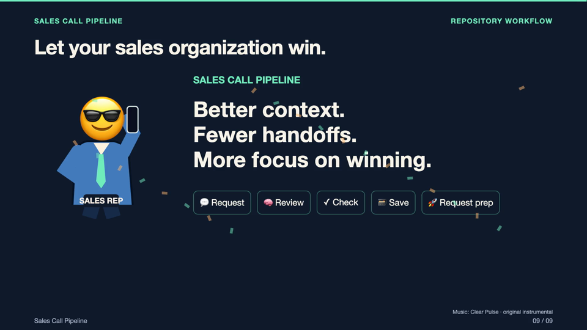
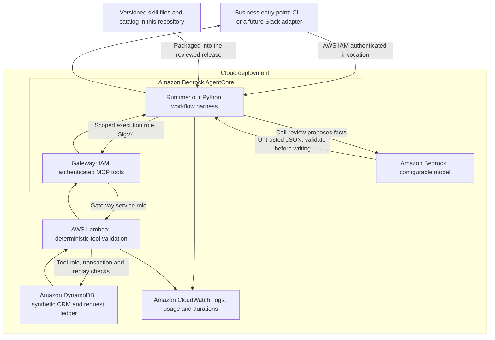

# Sales Call Pipeline

**Preserve the context from a good sales call. Reduce the handoffs that follow it.**

[](https://github.com/imrohankataria/sales-call-pipeline/actions/workflows/ci.yml)

A sales workflow building block: review a transcript, check proposed opportunity facts before saving them, and prepare the next meeting from the shared record. It brings a pattern from Rohan's production experience into a reusable Python and AWS reference project.

A good call can still lead to lost context when a rep has to rewrite notes, update a record and explain the same conversation to the account executive. This project follows that context through a repeatable workflow, so the sales organization can spend more attention on winning.

## Watch the product demo

[](https://github.com/imrohankataria/sales-call-pipeline/raw/refs/heads/main/docs/media/sales-call-pipeline.mp4)

[Watch or download the video](https://github.com/imrohankataria/sales-call-pipeline/raw/refs/heads/main/docs/media/sales-call-pipeline.mp4) · [Captions](docs/media/sales-call-pipeline.srt) · [Video and code walkthrough](docs/video-walkthrough.md)

The film shows the AWS/Slack reference implementation, including task selection, a queued worker, versioned instructions in S3, model proposals, checked tool calls, shared storage and the reply to Slack. It also labels the broader Salesforce workflow as Rohan's production experience. Salesforce, richer intent/coaching fields and revenue uplift are not claimed as integrations or measured outcomes of this repository.

## Choose your starting point

| Path | What is included | Where to start |
|---|---|---|
| Portable workflow | Local SQLite demo, bounded extraction, reusable skills, and cloud adapters | [Local quick start](#start-locally) |
| AWS/Slack reference behind the video | Signed Slack ingress, queue/worker handlers, user grants, Runtime Python, pinned S3 skills, MCP tools and model-assisted prep | [Reference source and setup](reference/slack-agentcore/README.md) |

The portable package is deliberately smaller than the deployed reference. The reference source comes from the AWS/Slack implementation previously verified in this project; copying it into a new checkout does not provision those resources. The [walkthrough](docs/video-walkthrough.md) maps each video layer to its code.

## Architecture

The diagram below describes the portable package. View its [layered architecture diagram](docs/architecture.svg), or the [Slack reference request path](reference/slack-agentcore/README.md#request-path) for the flow shown in the film.



Local mode uses the same workflow with SQLite and deterministic extraction, without AWS or a model call. The cloud adapters implement the Runtime → Bedrock → Gateway → Lambda → DynamoDB path. Cloud deployment is guided by the prompt below; this starter has not been live-deployed or load-tested.

## Start locally

Requires Python 3.12+ and Git.

```bash
git clone https://github.com/imrohankataria/sales-call-pipeline.git
cd sales-call-pipeline
python3 -m venv .venv
source .venv/bin/activate
python -m pip install -e .
python scripts/check_setup.py --init --mode local
python -m unittest discover -s tests -v
python -m gtm_starter
```

The demo lists skills, reviews a synthetic call, and reads the saved facts for meeting prep. Try your own JSON with `python -m gtm_starter --payload examples/call-review.json`.

The Python package and command use `gtm_starter`; the GitHub project is named Sales Call Pipeline.

For offline AWS SDK and Runtime checks, install `python -m pip install -e '.[aws]'` and rerun the same test command. Those checks are skipped in the dependency-free local install; they use synthetic responses and make no AWS calls.

## Configure and extend

The setup command creates private `.env` and `config.local.json` without overwriting them. Follow [accounts and authentication setup](docs/setup.md) to create/reuse selected accounts, fill required fields and verify sign-in first. `.env` holds optional local Slack or API-harness keys; AWS uses a named CLI login/SSO profile. The local demo needs no keys, and the current workflow does not automatically load `.env`.

The deployment prompt uses `config.local.json` for region, model, resource names, enabled skills, token limit, TTL and log retention. Runtime settings use `GTM_MODEL_ID`, `GTM_ENABLED_SKILLS`, `GTM_MAX_TOKENS` (1–4096), `GATEWAY_URL` and `GATEWAY_TARGET`.

Skills live in `src/gtm_starter/skills/<name>/<version>/SKILL.md`; their version, path and tools are in `catalog.json`. Add a skill, its reviewed handler in `core.py`, and acceptance cases. A catalog entry alone does not implement a workflow. Publish a new version and release the tested code/catalog combination together. For example, add `renewal-check` to read saved renewal facts and calculate a deterministic reminder; an external calendar integration would need a separately reviewed MCP tool.

For another vertical, reuse the package structure, tests and deployment method. Deploy a separate Runtime and scoped roles when ownership, data access or operational requirements differ. Add that vertical's skills and integrations.

## Identity and safety

No real API keys, Slack tokens, AWS credentials or account-specific deployment outputs are included. Keep private local keys in ignored `.env`; the shared `.env.example` stays blank. Cloud access uses AWS CLI sign-in/SSO and temporary IAM credentials; service roles provide the resource permissions. Skills contain instructions, not credentials. The enabled-skill list is deployment configuration, not a per-user authorization system.

For the portable package, enterprise OAuth delegation, Slack ingress, per-user grants, managed Policy, managed Evaluations, Memory and a durable queue are extension points. The included Slack reference implements signed ingress, application grants and queue/worker processing. Forwarding an available AgentCore workload token does not create enterprise OAuth permissions. Add an authenticated user mapping and independent tool/resource enforcement before introducing real user data.

The evidence validator intentionally understands only three explicit phrases in synthetic transcripts. It does not prove general semantic accuracy or complete extraction. Each accepted review replaces the opportunity snapshot with its supported findings; it does not merge CRM field updates. Cloud records become eligible for expiry after the configured TTL; replay protection lasts while request records remain. A review makes one application-level model call with bounded SDK retries and an explicit output-token limit; a replay can repeat extraction, but cannot repeat the CRM write while the ledger exists. Meeting prep makes no model call.

The Lambda binds each operation to the tool name in Gateway's invocation context, then validates arguments independently. The MCP adapter checks response IDs and fact shapes, and refuses HTTP redirects for signed requests. Runtime returns a bounded `rejected` or `failed` reason when a request cannot complete. These checks complement IAM; they do not implement per-user grants.

## AWS free credits

Eligible new AWS customers can receive **up to $200 in credits**, subject to current terms. Check your own credits, expiry and service access before deployment. AWS's current Free Tier page lists **AgentCore as Paid-plan exclusive**; eligible credits may still offset usage on a Paid plan. Do not assume a Free plan enables every component. Model calls, Runtime compute, storage and logs can consume credits; Paid-plan usage beyond eligible credits is billable. Set a budget and keep a teardown plan. See [AWS Free Tier](https://aws.amazon.com/free/) and [AgentCore pricing](https://aws.amazon.com/bedrock/agentcore/pricing/).

## Copy a prompt

Start with [the setup-first prompt](prompts/setup-first.md), then [local development](prompts/start-here.md) or [cloud deployment](prompts/deploy-aws.md). Codex uses [AGENTS.md](AGENTS.md), Claude uses [CLAUDE.md](CLAUDE.md), and other coding harnesses use [HARNESS.md](HARNESS.md). These are prompts for your coding assistant, not automatic deployment scripts.

The [infrastructure notes](infra/README.md) map configuration to deployment parameters and explain permissions, release rollback and cleanup. See [the sharing blurb](docs/share.md) for a short Beehive/LinkedIn description.

The repo includes tests for evidence, conflicting facts, replay, skill routing, persistence, tool routing and cloud-boundary validation. See [the package review](docs/review.md) for verification scope and remaining deployment checks. Passing local tests does not establish cloud readiness or a production SLA.
