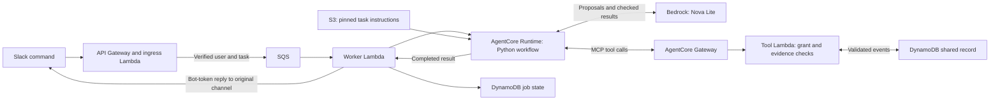

# AWS and Slack reference behind the video

This is the source of the queued AWS/Slack workflow illustrated in the
[product demo](../../docs/media/README.md). It preserves the previously verified
implementation while replacing its hardcoded S3 bucket owner with required
`AWS_ACCOUNT_ID` configuration. Private deployment outputs are excluded.

## Request path



`/gtm skills` is a separate immediate, private ingress response. It returns the
user's configured permitted tasks without invoking Runtime or reading S3.
`/gtm meeting-prep` is a second explicit request, not an automatic side effect
of call review. It reads the checked record through MCP before Nova drafts.

## Run the offline checks

From the repository root, reuse a Python 3.12+ environment:

```bash
python -m pip install -r reference/slack-agentcore/requirements.txt
PYTHONPATH=reference/slack-agentcore/src AWS_EC2_METADATA_DISABLED=true \
  python -m unittest discover -s reference/slack-agentcore/tests -v
```

The tests exercise signature verification, task permissions, pinned skill
integrity, model/tool boundaries, commit replay and retry behavior with local
fixtures. They do not send Slack messages or invoke AWS.

The original tool validator shares code with a bounded exercise API. Its
dependency modules are included to preserve behavior; they are not a new
curriculum or a requirement to use the sales workflow. `source-provenance.json`
binds this source copy to its origin.

## Configure a deployment

Start with the repository's [account and authentication guide](../../docs/setup.md).
The portable [deployment prompt](../../prompts/deploy-aws.md) applies to the
top-level package; this reference additionally requires the following wiring:

| Component | Required configuration |
|---|---|
| Ingress Lambda, `slack_handlers.webhook` | `SLACK_SECRET_ARN`, `QUEUE_URL` |
| Queue worker, `slack_handlers.worker` | `SLACK_SECRET_ARN`, `AUTH_SECRET_ARN`, `JOBS_TABLE`, `RUNTIME_ARN`; the `demo` Runtime endpoint |
| Runtime, `agent_app.py` | `AWS_REGION`, `AWS_ACCOUNT_ID`, `SKILL_BUCKET`, `SKILL_CATALOG_KEY`, `GATEWAY_URL` |
| Gateway tool Lambda, `gateway_tools.handler` | `AUTH_SECRET_ARN`, `CRM_TABLE` |

Provide a private Slack secret with `bot_token`, `signing_secret`, `team_id`,
`allowed_users` and `skill_grants`. Provide a separate execution-authorization
secret with a `secret` field. Grant the intended team and user only the selected
tasks. Slack uses the `commands` and `chat:write` scopes. Register `/gtm` against
the implemented signed HTTP endpoint; the bot must be a member of the reply
channel. Put local setup keys in ignored `.env`, and use service secret storage
for deployed functions. Never paste actual values into these docs or Git.

Provision scoped roles for ingress, worker, Runtime, Gateway and tool Lambda.
The worker needs permission to invoke Runtime for the verified user. Register
the three `crm-tools` Gateway tools and a content-verified catalog for the
versioned files in `skills/`. IAM controls AWS access; short-lived signed grants
independently restrict application tool, task, request and opportunity scope.
The workload identity token does not supply Salesforce OAuth permissions.

The CRM table uses `opportunity_id` and `event_id` keys; the job table uses
`request_id`. Both use a `ttl` attribute. Configure SQS worker delivery, partial
batch failures, a dead-letter queue, log retention and a failure alarm. The
source uses a 130-second job lease, so visibility and retry settings must leave
time for the bounded worker to finish. Infrastructure and live authentication
must be verified in the target project before this becomes a working checkout.

## Operational boundaries

The reference intentionally accepts only `demo-` opportunities and explicit
amount, stage and renewal-date phrases. Keep those constraints during learning;
using real business data requires a separately reviewed validation/access
contract. Historical live verification establishes the origin of the code,
not readiness of someone else's deployment.

Writes are idempotent for a retained opportunity/request intent. A changed
transcript under the same ID conflicts. Record TTL is 24 hours and deletion is
eventual. Reads use a bounded history. Repeated work can reuse saved results,
but a crash after Slack accepts a message and before its timestamp is saved can
duplicate delivery. This is not an exactly-once Slack guarantee. The included
code does not configure automatic training, managed online Evaluations,
Salesforce/Outreach OAuth, or unlimited throughput.
